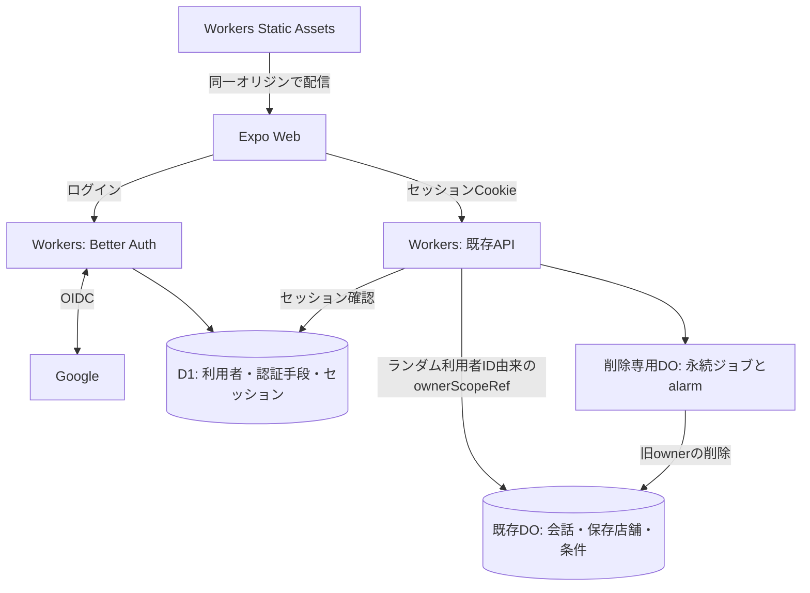

# Web認証の採用方針（未実装）

Web向け認証の採用構成と境界の決定を記す。実装済みの仕様や検証成功を示さず、READMEの現行仕様一覧には含めない。
現行の動作は[製品仕様](product.md)、認証・所有者の契約は[契約とデータの扱い](devlop/contracts.md)、責務は[アーキテクチャ](architecture/architecture.md)を参照する。実装のタスク・進捗・検証証跡は[GitHub Issues](https://github.com/takapom/ima-app/issues)で管理する。

## 採用構成と提供範囲

**Webを先行し、Better Auth＋Cloudflare Workers＋D1でGoogleのOIDCログインを提供する。**
Cloudflareを実行・保存基盤に使い、認証フローとセッション管理は既存ライブラリに任せる。Better Authの更新・運用はアプリ側で管理する。

| 項目         | 決定                                                                                         |
| ------------ | -------------------------------------------------------------------------------------------- |
| 対象         | 一般利用者向けのExpo Web。会話・検索・保存の利用開始前にログインを必須にする                 |
| ログイン手段 | Googleのみ。匿名利用・アカウント連携を提供しない                                             |
| 今回の対象外 | iPhoneの認証導入・Apple・LINE・Android・課金・会員ランク・管理者画面                         |
| データ共有   | 同じGoogleアカウントの会話・保存店舗・条件をブラウザ間で共有する                             |
| 既存データ   | 端末owner credentialから移行せず、新しい所有者として開始する。旧データの処置は切替条件とする |
| セッション   | 未利用30日で失効し、利用中は更新する。複数ブラウザの同時ログインを許可する                   |
| ログアウト   | このブラウザ・全ブラウザの操作を提供する。端末一覧や個別の遠隔ログアウトは追加しない         |
| 退会         | 即時利用停止・全セッション失効後に順次削除する。復元期間は設けない                           |
| プロフィール | メール・表示名・Googleの識別子を保持する。編集・画像表示は追加しない                         |
| 費用・配信   | Cloudflare全体をFreeに限定し、当面は`workers.dev`で検証する。上限超過時の停止を許容する      |

- Better AuthにGoogleとの認証往復・検証・セッション管理を任せ、D1へ認証データを保存する。業務データは既存DOに残す。[Google対応](https://better-auth.com/docs/authentication/google)、[DB対応](https://better-auth.com/docs/concepts/database)
- Expo Web・認証・APIを同一オリジンで配信する。[Workers Static Assets](https://developers.cloudflare.com/workers/static-assets/)
- Webの検索・送信にはTurnstileと既存の技術的レート制限を適用する。ログイン・CSRF対策とは別に検証する。[Turnstile公式](https://developers.cloudflare.com/turnstile/)
- iPhoneのCookie／Bearer選択、Apple固有の資格・callback・失効処理、App Attestの鍵の再設計は今回行わない。Web認証にネイティブ向けのCSRF例外を設けず、既存のApp Attest契約も変更しない。

## 認証境界と入出力

以下は追加・変更する方針であり、現行APIとして呼び出せることを示さない。

| 入口                 | 役割                                                                                                  |
| -------------------- | ----------------------------------------------------------------------------------------------------- |
| `/api/auth/*`        | Better AuthによるGoogleログイン・セッション確認・ログアウト。他の登録経路・アカウント連携を無効化する |
| `GET /v1/account`    | 認証済み利用者の最小限のプロフィールを返す                                                            |
| `DELETE /v1/account` | 対象Googleアカウントでの5分以内の再認証と確認後に退会を受け付ける                                     |
| 既存の`/v1/*`業務API | 検証したセッションを既存の所有者分離へ接続する                                                        |

- Web公開環境では`X-App-Token`・端末owner credentialをサーバー側のセッション検証へ置き換える。旧方式を公開APIの代替入口として残さず、開発用認証は開発環境に限定する。既存iPhoneとの同時提供・互換維持は今回の要件に含めない。
- 利用者IDはサーバーで暗号学的に安全なランダムIDとして発行し、HTTP認証境界だけで安定した`ownerScopeRef`へ変換する。メール・Googleの`sub`・端末IDから導出せず、クライアントに所有者を選ばせない。旧`owner-<credential hash>`と接頭辞を分け、再登録時には新しい利用者ID・ownerを発行する。CoreへBetter AuthのSDK・型を持ち込まない。
- Googleアカウントの識別にはProviderの識別子を使い、メール一致で別の利用者を連携しない。複数Provider間のメール衝突案内は今回不要とする。
- セッションのCookieキャッシュを無効にし、各HTTP入口でD1上のセッションを検証する。ProviderのID tokenを業務APIのセッションとして使用しない。[セッション管理](https://better-auth.com/docs/concepts/session-management)
- 退会の再認証には、同じGoogleアカウントで新しい認証往復を完了した証跡を使う。既存セッションの作成日時・期限延長や、別アカウントでの認証で代用しない。
- 未認証ならログイン画面、認証済みなら既存の入口へ進む。通信失敗を未認証と混同しない。設定にはアカウント確認・ログアウト・全ブラウザログアウト・退会を追加する。
- ログアウト・アカウント変更時は、そのブラウザの通信・表示状態・永続キャッシュを破棄する。他ブラウザも失効検知時に同じ処理を行い、owner間でキャッシュを混在させない。
- secretはWorker secretに置く。認証情報・メール・OIDC応答をログへ出さない。

## Cookie・CSRF・Googleトークン

- セッションCookieはHttpOnly・Secure・SameSite=Lax・host-onlyとし、環境間で共有しない。[Cookie設定](https://better-auth.com/docs/concepts/cookies)
- Cookie認証の更新系`/v1/*`には共通HTTP境界でCSRF対策を適用する。Origin、欠落時はRefererのオリジンを設定済みWebオリジンと照合し、Fetch Metadataがあれば併せて検証する。出所を確認できない要求は拒否する。ヘッダー欠落をネイティブ扱いの例外にせず、SameSiteやTurnstileだけに依存しない。[OWASPのCSRF対策](https://cheatsheetseries.owasp.org/cheatsheets/Cross-Site_Request_Forgery_Prevention_Cheat_Sheet.html)
- Better Authの`trustedOrigins`による`/api/auth/*`の保護は、業務APIのCSRF対策と分ける。OIDCのstate・nonce・戻り先の検証はライブラリに任せ、無効化しない。
- Google APIの追加権限・オフラインアクセスを求めず、認証に必要な情報だけを取得する。Googleのaccess token・refresh token・ID tokenは認証処理中だけ扱い、DB・Cookie・削除ジョブへ永続化しない。アプリのセッション更新はGoogleトークンに依存させない。
- Better Authのaccountにはトークン用の任意列があるため、既定設定のまま保存しない。公式の作成・更新前DBフックで保存データから除外する方針とし、初回・再ログイン双方の実保存値とセッション動作で成立を確認する。`storeAccountCookie: false`だけでDBへの保存停止になるとは扱わない。[DBスキーマとフック](https://better-auth.com/docs/concepts/database)、[account設定](https://better-auth.com/docs/reference/options#account)

## セッション失効と実行中処理

- このブラウザのログアウトは現在のセッション、全ブラウザログアウトは対象アカウントの全セッションをサーバー側で失効させる。以後のHTTP要求は拒否する。
- SSEは接続開始時に認証し、接続寿命を最長60秒か認証時点のセッション期限の早い方に制限する。イベントが来ない場合も期限で閉じ、再接続ごとに認証する。再接続は同じrunの再照会とし、追加生成しない。
- 全ブラウザログアウト後も既存SSEへの配信が最長60秒続くことを許容する。このブラウザのログアウトではクライアントが直ちに切断する。即時の全接続失効や定期的なD1照会のためにrunとセッションを結び付けない。
- 通常ログアウト・セッション期限切れ・通信断では受理済みrunを止めない。退会時は旧ownerの実行・配信・書込みを停止し、遅着した確定や再試行でも復活させない。外部Providerへ受理済みの処理・費用の取り消しは保証しない。

## 退会と削除対象

- owner単位のSQLite-backedな削除専用DOとalarmを使う。受付時に旧ownerの利用停止と削除ジョブを認証行から独立して永続化し、D1のuser・account・sessionを速やかに削除する。途中失敗でも利用停止を維持し、認証行の削除もジョブから再試行できるようにする。[Alarmsの再試行仕様](https://developers.cloudflare.com/durable-objects/api/alarms/)
- 認証行の削除後は同じGoogleアカウントで再登録でき、新しい利用者ID・ownerを発行する。削除ジョブは旧ownerと削除対象の認証行IDだけを扱い、メール・Google識別子による後追い削除で新しいアカウントを巻き込まない。
- 今回はGoogleのProviderトークンを保存せず、外部トークンの失効待ち・暗号化保管・再登録保留を削除ジョブへ追加しない。アプリ管理データの削除とGoogle側の同意設定の解除を区別する。
- 削除は冪等にし、失敗時はalarmを再設定して継続する。自動再試行の回数上限だけに依存せず、未完了を成功と記録しない。

| 削除対象              | 内容                                                                     |
| --------------------- | ------------------------------------------------------------------------ |
| D1認証行              | user・account・session、および利用者に紐づく一時的な認証情報             |
| ConversationHistoryDO | 旧ownerの会話・発言・要約・run・削除／配送再試行参照・メモリ応答         |
| ThreadDOとowner索引   | 旧ownerの全Threadの実行・本文・候補・写真／配送参照と列挙用索引          |
| SavedReferenceDO      | 旧ownerの条件・保存店舗参照・決定時刻・identity索引                      |
| 共有TelemetryDO       | `owner_scope_ref`に一致するevent・trace行だけ。他ownerは維持             |
| 共有RateLimitDO       | `owner:<旧owner>`のbucket。アカウント横断のdevice bucketは維持し期限処理 |
| ブラウザ              | セッション・表示／永続キャッシュ。他ブラウザは失効検知時に破棄           |

- 会話APIと`POST /v1/threads`の両作成経路で、Thread初期化前にownerから列挙できる参照を永続化する。索引への登録失敗時は作成を進めず、再送は冪等にする。保存・決定で使う`/v1/threads/:id/saved`・`/decided`を含む既存入口は、この理由で一括廃止しない。
- 削除中のownerへの新規処理・遅着書込み・配送を止め、削除完了後も古い参照からデータを復活させない。再登録したownerは旧ownerと分離する。
- ブラウザ間共有・再ログインで店舗情報・写真・生成文の保持期限を延長しない。[Providerポリシー](provider-policy.md)を適用し、外部保存面の削除保証は[運用](operations.md#観測と証拠の範囲)に従って別に検収する。

## 採用・切替の条件

- 詳細実装に進む前に、既存Think／AI SDKを含むWorker全体へGoogle 1 Provider＋D1セッション確認を足した最小構成で、Free枠内で成立するかを判定する。CPU・起動時間・bundleサイズ・D1読み書き行数と遅延を測り、トークン非保存も確認する。成立しなければ公開せず、構成を再検討する。
- CPU 10ms等の現行Free上限を基準にする。圧縮後3MB制限は2026-09-04に撤廃され、サイズ上限は展開後64MiBへ変更されたため、古い数値を採用しない。[Workers制限](https://developers.cloudflare.com/workers/platform/limits/)、[サイズ制限の変更](https://developers.cloudflare.com/changelog/post/2026-09-04-increased-worker-size-limit/)
- 最小構成の成立後も、ログイン・セッション更新／失効・60秒ごとのSSE再接続・削除再試行を含むD1／DO／Workersの使用量で公開可否を判断する。Free枠に収まらなければ公開せず、自動で有料化・保護省略をしない。[D1料金](https://developers.cloudflare.com/d1/platform/pricing/)、[DO料金](https://developers.cloudflare.com/durable-objects/platform/pricing/)
- 切替前に旧ownerのデータと利用環境を棚卸しする。個人検証データだけの環境は、対象を特定して人の明示的な指示のもとで旧Thread・会話・保存・AppIntegrity・共有DO内の該当行等を廃棄する。他利用者のデータがある場合は処置を決めるまで切り替えず、「移行しない」を放置の理由にしない。
- Threadには継承元の[保持期限alarm](../worker/src/platform/entrypoints/cloudflare/runtime-production-host.ts)がある。これを維持・検証しつつ、旧データの全削除やowner索引の代わりとは扱わない。
- 環境別Google client ID・HTTPS callback・trustedOrigins・Turnstile許可ホストを固定する。`workers.dev`は[Public Suffix List](https://github.com/publicsuffix/list/blob/master/public_suffix_list.dat)に含まれるため、本番ブランド確認・ドメイン権限の要件を満たせるか別に確認する。[Google OAuthポリシー](https://developers.google.com/identity/protocols/oauth2/policies)
- 独自ドメインは初期採用を推奨するが、費用の選択は従来の検証方針から自動で変更しない。後日移行する場合はCookie・Google callback・trustedOrigins・Turnstile・Web接続先をまとめて切り替え、再ログインを必要とする。設定・secret・データ削除・デプロイは[運用](operations.md)に従う。
- 実装時に製品仕様の対象・ログイン必須・アカウント共有と、契約のowner credential手順を更新する。採用方針だけで現行の動作記述を先行変更しない。

## 振る舞いの受入条件

- Googleの初回／再ログイン・取消・失敗・再試行と、state／nonce・戻り先の検証が成立する。初回・再ログイン・再認証でProviderトークンが永続化されない。
- Cookie認証の更新系で不正なOrigin／Referer・Fetch Metadataと、出所不明の要求を拒否する。Turnstileの欠落・不正・再利用、旧認証方式への迂回も拒否する。
- 同じGoogleアカウントのブラウザ間共有と別ownerの会話・保存・写真の拒否、切替時のキャッシュ分離が成立する。
- ログアウト後の新規HTTPを拒否し、既存SSEは最長60秒で閉じて再認証する。無通信時・連続イベント時にも上限を守り、runの二重生成・通常ログアウトによる中断を起こさない。
- 退会の再認証・各段階での停止／再起動・alarm重複／長期失敗・同じGoogleアカウントでの再登録を検証する。旧run・旧ジョブ・遅着書込みが新アカウントや他ownerへ影響せず、両Thread作成入口の索引から旧データを削除できる。
