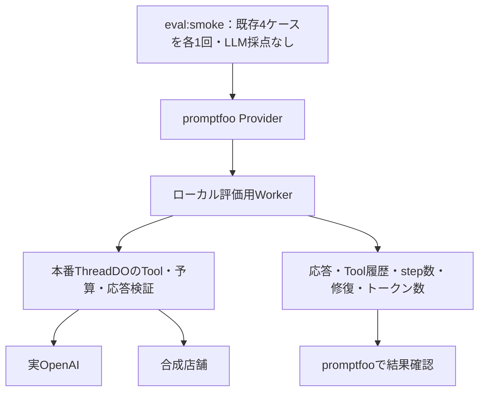

# #87：既存の評価基盤を検証し、疎通確認の入口を仕上げる

**既存実装を活かし、未捕捉の`spawn`エラーを修正して、既存4ケースを選ぶ`bun run eval:smoke`を追加します。** 有料の実モデル確認は、ユーザーの手元で行います。smokeはLLM採点を行いませんが、本番ターンのモデル呼び出しには利用料が発生します。

[PR #90](https://github.com/takapom/ima-app/pull/90)はマージ済みです。今回の調査でもNode 24.11.1で評価関連の単体テスト・実SDK/DOの統合テスト・評価コードの型検査が通りました。現在のmainでの実モデル疎通は未確認です。

## 全体構造

promptfooは実行と結果閲覧、ProviderはWorkerの起動と入出力変換、評価用Workerは本番ターンの実行を担当します。

## 実装する内容と順序

1. **起動失敗の回帰テストを書き、既存仕様に反する箇所を修正する。**
   [Provider](../worker/tooling/eval/promptfoo/provider.ts)は、起動途中の終了とタイムアウトをすでに`callApi`で捕捉して`error`として返し、`ready.catch(stopWorker)`と`exit`イベントで参照も解除しています。不足は、Wranglerの不在（ENOENT）や実行権限不足（EACCES）などで発生する、未捕捉の`error`イベントです。[既存の開発文書](devlop/development.md#プロンプトとtoolの評価promptfoo)にある「起動失敗をERRORとして表示する」仕様の修正として扱います。

   最初に`workerDir`を一時ディレクトリへ向け、envファイルと偽の`node_modules/.bin/wrangler`だけで、実行ファイルなし・即座に`exit 1`・終了せず待ち続ける、の3パターンを作ります。Node 24.11.1で実際にどれがプロセスを異常終了させるか確認してから修正します。本番側にテスト用の設定項目は追加しません。

   `child.once('error')`で受けた失敗を起動待ちPromiseのrejectへ接続し、ポーリングなどの待機も終了させます。終了・タイムアウト・参照解除の既存処理は回帰テストで維持します。起動エラーの返却には生のstderrを添付せず、固定の説明と、必要なエラーコード・終了コード・タイムアウト時間だけを使います。

   起動失敗を記憶せず、後続ケースで起動し直す既存方針を維持します。起動待ちの既定値は120秒のままとし、ケースごとに再待機が発生し得ること、起動エラーが続く場合は中断して手動診断することを文書化します。

2. **`bun run eval:smoke`を追加する。**
   専用設定でも`tests: file://cases/*.yaml`を参照し、以下の既存4ケースに`metadata: { smoke: true }`を付け、`--filter-metadata smoke=true`で選択します。ケースの発話・位置条件・個別アサーションを複製しません。各1回、同時実行2、キャッシュ無効で実行します。

   | 既存ケース                                                   | 位置条件  | 既存の合格条件                                   |
   | ------------------------------------------------------------ | --------- | ------------------------------------------------ |
   | 現在地あり・地名なし → 甘いものを現在地周辺で探して提案する  | available | 最初の検索が現在地、`propose`で確定              |
   | 位置情報を拒否・地名なし → 現在地で検索せず、地名を1つ尋ねる | denied    | 現在地で検索しない、`ask`で確定、質問符は最大1つ |
   | 地名あり・現在地もあり → 現在地より地名を優先して探す        | available | 地名検索を行い、`propose`で確定                  |
   | 該当店なし（札幌） → カードを出さずに状況を伝える            | denied    | `noCards`：カードなし、かつ`propose`以外で確定   |

   smokeの`defaultTest`に共通ゲートの`committed`と`noOpenNowClaim`を明示し、既存関数を参照します。共通スコアの`noRepairs`は既存どおり`weight: 0`で記録し、個別ケースのゲートとスコアもそのまま使います。LLM採点のアサーションと採点用Provider設定は含めません。

   札幌に`kindIs: answer`や検索結果0件の必須判定を追加せず、拒否ケースにも検索ゼロを要求しません。合格条件を強化する場合は#88で扱います。Toolの呼び出し順の完全一致は要求しません。

   `--filter-metadata`は[promptfoo 0.123.1の公式ソース](https://github.com/promptfoo/promptfoo/blob/0.123.1/src/commands/eval.ts#L125)と配布コードで対応を確認済みです。実装時には、その版のCLIで選択が4件に限られることと、LLM採点が実行されないことを検証します。

3. **実行手順と証跡を整える。**
   開発文書に、Node 24.11.1での実行方法、課金対象、結果閲覧、失敗時の確認方法を追記します。既存の`bun run eval`による40ケース＋LLM採点は維持し、smokeは4ケース・モデル呼び出しのみの課金であることを書き分けます。

   stderrを結果に保存しない代わりに、`worker`ディレクトリで`bunx wrangler dev --config wrangler.eval.jsonc --env-file .dev.vars.llm --local --ip 127.0.0.1 --port 8791 --show-interactive-dev-session=false`を手動実行する診断手順を記載します。既存の評価プロセスを停止してから実行し、診断出力をpromptfooの結果やIssueへ転載しません。

## 契約・設定の扱い

- 本番の公開API・プロンプト・Tool・予算は変更しません。
- Providerの返り値は、既存の「閲覧用`output`＋構造化した`metadata.evalRun`」を維持し、モデルIDや費用のフィールドは追加しません。
- smokeのCLIには`--env-file`を渡さず、Worker側だけが既存のsecretファイルを読みます。開発文書の「promptfooも同じファイルを読む」は、LLM採点を伴う既存の`eval`だけの説明として書き分けます。
- promptfooは既存判断に従い`bunx promptfoo@0.123.1`を維持します。
- テレメトリ・更新確認・共有を無効化し、結果はローカルに保存します。テレメトリ設定は[公式資料](https://www.promptfoo.dev/docs/configuration/telemetry/)に従います。

## モデルと費用の記録方法

- モデルIDとreasoning effortは、実行対象コミットの[OpenAI設定](../worker/src/infrastructure/adapters/out/providers/openai/provider-config.ts)から手動記録します。設定上のモデルIDとコミットSHAを残し、実際のモデルのsnapshot版を確認したことにはしません。snapshot版が取得できなければ未確認と記録します。
- 現在のカスタムProviderは`cost`を返さないため、promptfooの画面に実行費用が表示されることを完了条件にしません。費用はユーザーがOpenAIの管理画面で確認した実額を記録し、今回の実行分を分離できなければ未確認とします。
- トークン数と実行時の公式料金表から計算する場合は概算と明記します。現在の記録にはキャッシュ内訳がなく、請求額と一致する保証はありません。参照した料金表と計算条件も残します。

## 検証と完了条件

- 起動失敗・途中終了・タイムアウトで、未処理エラーを出さずにERRORが返り、待機と失敗したWorkerの参照が残らないことを回帰テストで確認します。
- smokeが既存4ケースだけを選び、共通ゲートと個別アサーションを維持し、LLM採点を行わないことを確認します。
- 既存の検索条件、プロンプト差し替え、失敗と0件の区別、結果へのキー・座標の非露出を再検証します。
- 関連テストと品質ゲート、本番buildへの評価コード非混入を確認します。静的・固定モデルの成功と実モデルの成功を分けて報告します。
- ユーザーが`bun run eval:smoke`と`bun run eval:view`を実行し、4ケースの結果と計測情報を確認します。
- 実行日時・コミットSHA・設定上のモデルID・reasoning effort・結果・トークン数・費用を#87へ記録します。snapshot版・費用の未確認と費用の概算を区別し、本文・キー・座標は記録しません。未確認の項目を測定済みや合格として扱いません。

実装はユーザーの明示指示に従い、mainから作成したPR用ブランチで進めます。①未捕捉の起動エラーの修正とテスト、②smoke入口と既存ケースの選択・関連検証・文書、の2コミットを基本とし、それぞれ追加＋削除2,000行以内に収めます。最初の作業は、3種類の起動失敗を再現する回帰テストです。#88の基準値取得と#89のTool改善は今回の対象外です。

この計画文書は、ユーザーによるdocsへの保存の明示指示に従って保持します。計画ファイルを追加しない一般規則を理由に削除したり、GitHub Issueへ移動したりしません。
